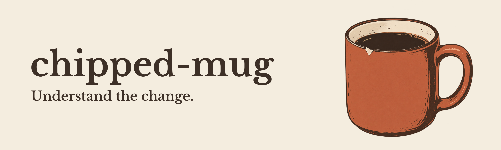

An [Agent Skill](SKILL.md) that explains code changes in plain English, using the repository as context.

For manual testers and other teammates who know the product but may never have opened the codebase.

Think of the senior developer with the chipped company mug: “Okay. Here’s what actually changed.”

## A change, explained

A synthetic example from a saved-article app: four changed files become this explanation, recorded using the skill from v1.0.0. The [full example and run details](examples/reading-room.md) are included.

> This change adds personal pins to the saved-article library. When the library is opened, pinned articles appear first and their labels begin with “Pinned: ”. Within both groups—pinned and unpinned—articles keep their original saved order.
>
> Pins belong to the signed-in member, so one person’s choices don’t affect anyone else’s library. Removing a pin returns the article to its normal place among unpinned articles. Pinning only affects articles already saved in that member’s library; it doesn’t add an article to the library.

Give them the part the developer usually explains.

## What to expect

The agent reads the selected change and the surrounding code it needs to understand it. It explains what changed, what happened before, and when the difference matters.

It does not review the code, look for bugs, design tests, compare the implementation with a ticket, or modify the repository. Conditions and fallback behavior still belong in the explanation.

It may read twenty files. You shouldn’t have to.

## Install and use

The skill is an instruction file for your coding agent. The agent needs Git and read access to the repository, including the versions being compared. It also needs access to any PR you link. There is no separate CLI or runtime.

Clone this repository:

```sh
git clone https://github.com/janmrow/chipped-mug.git
cd chipped-mug
```

Copy `SKILL.md` and `LICENSE` into the directory for your agent, creating it if needed:

| Agent | Install directory |
| --- | --- |
| [Codex CLI / IDE](https://learn.chatgpt.com/docs/build-skills) | `~/.agents/skills/chipped-mug/` |
| [Claude Code](https://code.claude.com/docs/en/skills) | `~/.claude/skills/chipped-mug/` |
| [OpenCode](https://opencode.ai/docs/skills/) | `~/.config/opencode/skills/chipped-mug/` |

For example, from inside the cloned repository, install for Codex:

```sh
mkdir -p ~/.agents/skills/chipped-mug
cp SKILL.md LICENSE ~/.agents/skills/chipped-mug/
```

Start a new session in the repository the PR belongs to. In Codex, select the skill with `$chipped-mug` or `/skills`; in Claude Code, use `/chipped-mug`. In OpenCode, ask the agent to use `chipped-mug`.

Then ask:

```text
Use chipped-mug to explain this pull request: <PR URL>
```

Replace `<PR URL>` with the pull request you want explained. You can also point it at a branch, commit, revision range, or diff; for a branch, name the base you want to compare against.

Without repository access or the needed versions, the agent can only give a limited explanation or ask for missing context.

To update, run `git pull --ff-only` inside the cloned repository and copy `SKILL.md` and `LICENSE` into your agent’s directory again, then start a new session.

These are local installation paths; remote and managed environments may use different routes.

Try it on the PR you were about to ask someone to explain.

## License

[MIT](LICENSE). The bundled Libre Baskerville font is licensed under the [SIL Open Font License 1.1](assets/source/OFL.txt). Editable artwork and export notes are in [assets/source/](assets/source/README.md).
